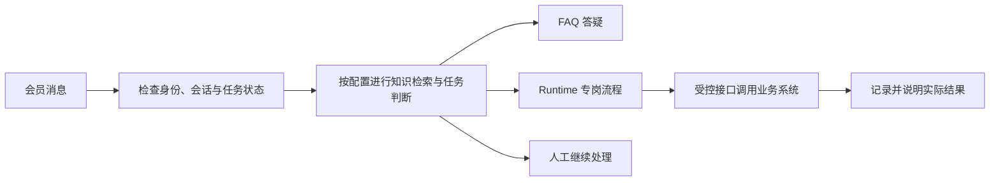

# SRICH CHAT · AI Agent 客服系统

**为 iGaming 运营而生的在线客服系统：AI 辅助设计页面与卡片，Runtime 协同 FAQ、专岗 AI Agent 与人工客服，把咨询接到实际处理结果。**

[官网](https://chat.s.rich/) · [帮助中心](https://chat.s.rich/docs) · [项目博客](https://bug.it.com/index.php/category/srich-chat/) · [English](README.en.md)

> 这是 SRICH CHAT 同一个商业软件项目的公开介绍与文档仓库。**不包含产品源码，不提供开源安装包。** 文中的 HTTP、JSON 与嵌入片段仅用于说明对接契约。

## 解决什么问题

会员问一次订单状态，客服往往要查另一个后台、复制编号、收材料、联系相关人员，再回来解释。运营想换页面颜色、卡片或常用字段，也可能再排一次开发。

SRICH CHAT 把这些工作连接起来：会员在运营商自己的网站里获得服务；客服在共享会话旁查看已接入的业务数据、发起受控操作；运营配置外观、内容、权限和岗位。买方保留自己的会员登录、业务规则与最终执行权。

面向自有会员网站和业务系统的运营公司，按独立部署软件交付。不是注册即用的公共 SaaS。

## 核心能力与效果

| 能力 | 使用效果 | 使用前置 |
| --- | --- | --- |
| AI 辅助页面与卡片设计 | 用自然语言描述品牌要求，预览草稿后应用或发布 | AI 配置；限支持的样式与结构 |
| 高自由度业务配置 | 字段、颜色、看板、按钮适应运营工作 | 业务数据与动作需接口配合 |
| FAQ 知识库 | 重复咨询按已维护内容回答 | 买方知识源；关键词不依赖 AI，语义检索需配置 |
| Runtime 与专岗 AI Agent | 按固定步骤收资料、查记录、协作并说明结果 | 已发布流程、所需业务接口与外部服务 |
| 持续会话与人工协作 | 会员重新认证与重连后接续服务，人工看到上下文 | 正确接入身份；历史受保留策略约束 |
| 会员自助查询 | 在聊天输入 `/`，得到自己的数据卡片 | 已对接看板并开放查询 |

AI 判断与实际执行分开：系统规则和任务状态先约束处理方式，知识或模型提供判断，Runtime 调用获准能力，业务系统给出结果。新增 AI 岗位可以复用能力；新业务动作仍需开发、验证和发布。

这是产品层面的示意，不代表每条消息都调用模型。已有任务按当前步骤处理；模型判断方式由部署配置决定。

## 看看实际界面

| 入口 | 看什么 |
| --- | --- |
| [会员演示网站](https://chatmock.s.rich/) | 聊天融入会员网站的方式 |
| [管理后台演示](https://chatdemo.s.rich/admin) | 页面、人员、业务与员工配置 |
| [客服端演示](https://chatdemo.s.rich/) | 共享会话与客服工作界面 |

演示账号说明见[官网演示板块](https://chat.s.rich/#demo)。可体验能力以演示环境当前配置为准。

## 先读产品，再按需要接入

- [为什么运营需要专门的 AI Agent 客服系统](articles/why-ai-agent-support.md)
- [AI Agent 为什么可以执行：消息、判断、Runtime 与结果](articles/why-agents-can-execute.md)
- [会员网站的客服应该是什么样](articles/member-support-experience.md)
- [高自由度配置与 AI 样式设计](articles/configuration-and-ai-design.md)
- [公开对接总览与阅读顺序](docs/integration/zh-CN/index.md)
- [全部接入指南目录](docs/README.md)
- [已发布博客文章目录](BLOG.md)

## 开始使用需要谁配合

先接会员身份与嵌入页面，再增加知识源、看板、操作、事件与员工。看板、操作、知识库、事件、信息、红包、外部系统写邮箱和查询共 8 项涉及买方开发配合；其中查询复用已接好的看板。AI、对象存储和 Telegram 等外部服务按实际启用能力准备。

网站、页面、客服、分组、快捷回复、管理账号与角色等日常配置由运营在后台完成。各类依赖有重叠，不能把后台有一个菜单理解为相关业务已经接通。

## 几个必须说准确的边界

- 持续会话不等于永久保留所有消息；默认启用 30 天清理，按运营策略保存。
- 信息给网页，过期不补；邮箱和事件进入聊天，按保留策略保存。
- AI 不直接写聊天表或买方业务表，业务动作走受控接口。
- 红包资金、名单、参与、开奖与发奖属于买方业务；这里提供通信与配置能力。
- 不承诺任意岗位零开发、模型零误判或通用的人力节省比例。

## 项目资料与反馈

内容整理日期：2026-09-22。公开指南覆盖接入方法、关键字段与验收，完整字段限制、错误码与部署版本契约以[帮助中心](https://chat.s.rich/docs)为准。

产品沟通可从[团队联系入口](https://bug.it.com/index.php/aboutus.html)开始；公开讨论只提供脱敏描述，不提交生产凭据或会员资料。文档内容不授予商业产品源码或部署使用权。

检索主题：AI Agent 客服系统、在线客服系统、智能客服、AI 客服系统、会员服务、客服系统对接。
